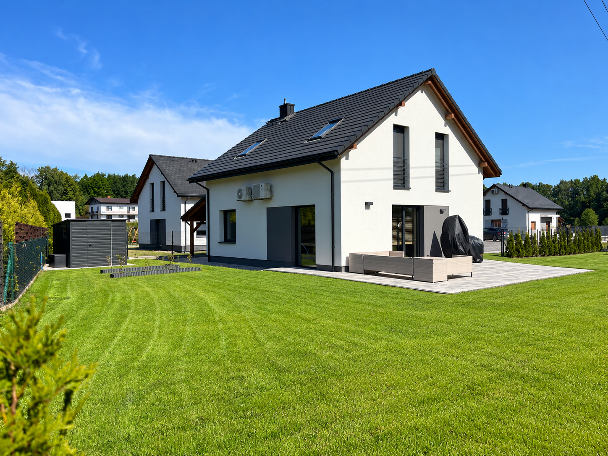

# Checkpoint — oferta Pisarzowice i retusz zdjęcia

Data: 19 października 2026. Baza kodu: `c4a9c51` (po scaleniu PR #7).

## Cel dalszej pracy

Realizujemy punkt 1 ostatniego audytu: spójny opis lokalizacji i etapu oferty oraz prawidłowe opisy zdjęć. Doprecyzowanie z właścicielem rozpoczęto przed implementacją.

## Ustalenia potwierdzone przez właściciela

- Jeden dom jest gotowy i czeka na sprzedaż.
- Dla całej inwestycji wystarczy krótki komunikat **„Etap II w trakcie realizacji”**. Nie rozbudowywać opisu o szczegóły przygotowań nieruchomości.
- Zdjęcie przedstawia oferowany dom. Istniejące opisy sugerujące sprzedany budynek z etapu I wymagają korekty.
- Właściciel zaakceptował poniższy wariant retuszu jako checkpoint do dalszej pracy.

## Zaakceptowany wariant zdjęcia

- Plik: `docs/checkpoints/assets/pisarzowice-house-retouch-2026-10-19.png`.
- SHA-256: `d874a4c046a974692169364c4c8387425583c10a5ea156a68b92a94d1be7bce2`.
- Źródło kadru: `src/assets/images/budowa-domu-jednorodzinnego-bielsko-biala.jpg` (ujęcie hero i sekcji „O firmie”).
- Usunięto niebieski peszel z trawnika przy tarasie i drzewko na pierwszym planie po prawej.
- Dodano lampy w miejscach wystających przewodów oraz wizualizację kostki przy sąsiednim budynku po prawej.
- Nowe lampy i nawierzchnia są elementami wizualizacji; akceptacja grafiki nie potwierdza ich wykonania na nieruchomości.
- Oryginał wygenerowanego pliku zachowano też w `/workspace/generated_images/exec-dfbb15a9-2209-4305-9d45-f4c1e14801b0.png`.

Checkpoint przechowuje zaakceptowany materiał. Aplikacja nadal odwołuje się do dotychczasowych zdjęć; nowy wariant nie został jeszcze zintegrowany z widokami.

## Dalsze kroki

1. Ujednolicić krótki komunikat etapu inwestycji na stronie głównej i podstronie oferty.
2. Usunąć z `src/data/properties.ts` błędne odniesienia do fotografii sprzedanego domu z etapu I oraz zwrot „Rozpoczynamy drugi etap”. Zachować potwierdzone parametry i cenę.
3. Dostosować wstęp `/domy-na-sprzedaz-bielsko`, który obecnie sugeruje gotowe domy w mieście Bielsko-Biała. Propozycja do dalszego doprecyzowania: „Domy na sprzedaż w Bielsku-Białej i okolicach”; przy konkretnej ofercie pozostaje Pisarzowice.
4. Przygotować integrację zaakceptowanego zdjęcia w istniejącym procesie Astro Picture (AVIF/WebP), z kontrolą jakości. Nie serwować źródłowego PNG bezpośrednio jako ciężkiego obrazu hero.
5. Przygotować zmiany do przeglądu w osobnym PR. Autoryzacja scalenia PR #7 nie jest zgodą na automatyczne scalenie tej kolejnej paczki.

Nie rozszerzać tej paczki na pozostałe punkty audytu bez dalszego ustalenia zakresu.

## Ostatni punkt odniesienia audytu

Audyt produkcji z 19.10.2026: Lighthouse (mediana trzech prób) Performance 98 mobile / 100 desktop; SEO, Accessibility i Best Practices 100; Agentic Browsing 4/4; isitagentready 53/100 (8/15). Potwierdzono 189/189 kontroli HTTP oraz 37/37 kontroli zgodności schema.

Artefakty tego audytu w bieżącym środowisku: `/workspace/shared/investdom-com-pl-audit-2026-10-19-090535/` (pełny raport, plan działań, PDF i dowody). Rzeczywista indeksacja i cytowania LLM pozostają niezmierzone.
